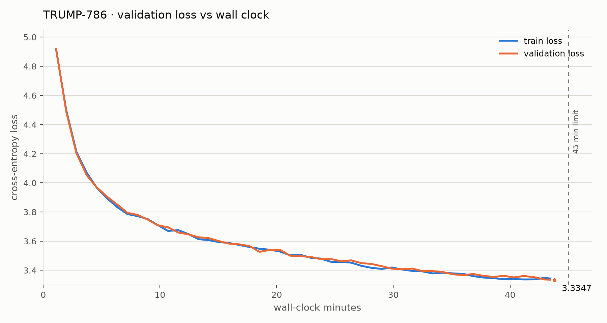

# Leaderboard submission: TRUMP-786

Adds an external entry to the OpenWebText validation-loss leaderboard.

```text
Model: TRUMP-786 (Tensor-Resonant Ultra-Micro Predictor)
Final validation loss: 3.33471
Wall-clock: 43m48s on one NVIDIA B200 180GB
Training data: provided OpenWebText training set
Validation context length: 512
```

Learning curve: https://forge.coreweave.com/wandb/whengeason-southeast-university/CS336-a1-B200-owt/runs/f1a7pz60 (wall-clock x-axis ends below 45 minutes).



## Method

TRUMP-786 is an 8-layer, 768-wide decoder-only Transformer with 12 heads,
`d_ff=2048`, RoPE, RMSNorm, SwiGLU, and a 32k byte-level BPE vocabulary.
Training uses batch 128, context 512, 25,000 steps (1.64B tokens), AdamW,
cosine learning rate from `2.8e-3` to `1e-4`, warmup 1,000, and bf16 autocast
with fp32 master weights and optimizer state.

The final validation loss is the mean of 20 validation batches at context 512.
