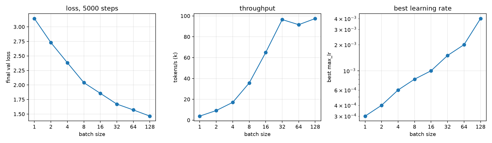

# 训练记录

2026-11-07。40k 步长训练的验证损失 1.3514，达到 1.45 的要求；基础模型 5000 步是 1.6798，学习率扫描的最佳值在 1e-3。

## 基础模型

模型 4 层、16 头、`d_model=512`、`d_ff=1344`、词表 10000、上下文 256。batch 32，5000 步，共 40.96M token，seed 42，单张 4090。

优化器 AdamW，`max_lr=1e-3`，`min_lr=1e-4`，warmup 200，余弦衰减到第 5000 步。最终 train loss 约 1.68，val loss 1.6798，耗时约 7 分钟。

## 学习率扫描

固定其他参数，只改 `max_lr`，`min_lr` 取 `max_lr / 10`：

| max_lr | min_lr | 最终 val loss | 说明 |
|---:|---:|---:|---|
| 1e-4 | 1e-5 | 2.3055 | 太小，5000 步内欠拟合 |
| 3e-4 | 3e-5 | 1.8789 | 比 1e-4 好 |
| 1e-3 | 1e-4 | 1.6798 | 目前最好 |
| 3e-3 | 3e-4 | 1.9276 | 开始变差 |
| 1e-2 | 1e-3 | 2.5702 | 明显变差 |
| 3e-2 | 3e-3 | 3.2364 | 还能缓慢下降 |
| 1e-1 | 1e-2 | 3.8232 | 很差，但没有 NaN |

`1e-1` 的验证损失在 300 步升到 4.52，后面随着学习率衰减又降到 3.82。`3e-2` 也有类似的早期上升。高学习率先失稳，余弦调度把它拉回来。

## 大学习率与稳定边缘

恒定学习率 1.0 是真正的发散：

| 设置 | 早期峰值 | 最终 val loss |
|---|---:|---:|
| 1e-2，余弦到 1e-3 | 3.34 @ 900 | 2.5702 |
| 1e-1，余弦到 1e-2 | 4.52 @ 300 | 3.8232 |
| 1.0，余弦到 1e-2 | 204.6 @ 300 | 3.9748 |
| 1.0，恒定 | 185.1 @ 300 | 172.3018 |

`1e-2` 在 800 步之前 val 从 3.36 降到 3.19，900 步附近抬头到 3.34，之后才继续下降。它已经有边缘附近的不稳定特征。`3e-3` 没有这个抬头，val 一路降到 2.44。

恒定 1.0 在 200 步后 val loss 就到 122.8，之后一直在 100 以上，5000 步仍有 172.3。余弦版同样先炸到 200 左右，随后缓慢回落，5000 步到 3.97。调度能把发散拉回来，但最后停在 3.97，远不如最佳学习率的 1.68。

`1e-1` 和 `1.0` 的最终学习率都是 `1e-2`，比基础模型的 `1e-4` 大 100 倍。尾部学习率降不下来，模型最后落在较差的区域。固定 `min_lr=1e-4`、`max_lr=3e-3` 的最终 val loss 是 1.9184，比同 `max_lr` 的 1.9276 略好，也说明最后阶段的学习率不能太大。

最佳学习率 `1e-3` 比 `1e-2` 的边缘低约一个数量级，比真正发散的 0.1–1.0 低两到三个数量级。按这组数据，民间说法“最佳学习率位于稳定边缘”在这套小模型、短 token 预算、AdamW 加 warmup 和梯度裁剪的设置下不成立。稳定边缘只说明哪里开始不稳，不决定最终损失。

公开的 CS336 笔记里也常见“1e-3 就是稳定边缘”的说法，但它们的扫描上限通常只到 1e-3 附近，没有继续测 1e-1 和 1.0。把上限抬高后，1e-3 仍然只是最佳值，离真正的发散点很远。

比较最佳学习率和边缘时，两者要在同一 token 预算下测；边缘用恒定学习率跑，余弦会把发散拉回来。发散判据取 val loss 连续多次上升或超过初始值一个数量级，不能只看最终值。

旧的 `1e-4` 恒定学习率 run 在第 2920 步中断，val loss 2.355，不能和跑满 5000 步的结果放在一起比较。

## 压到 1.45

5000 步只有 41M token。官方参考在 M4 上 40M token 的验证损失是 1.80，这里的 1.68 已经更好，但离 1.45 还有距离。学习率扫描解决的是“哪一档最快”，要压到 1.45 需要更多 token。

改用 40k 步，`max_lr=1e-3`，`min_lr=1e-4`，warmup 1000，余弦调度到第 40000 步。共 327.68M token，约占 TinyStories 训练集的 60.5%。4090D 上约 55 分钟，最终 train loss 1.3755，val loss 1.3514，达到 1.45 的要求。

| 训练 | 步数 | token | 最终 val loss |
|---|---:|---:|---:|
| 基础模型 | 5,000 | 40.96M | 1.6798 |
| 长训练 | 40,000 | 327.68M | 1.3514 |

检查点每 4000 步保存一次，最后一个是 `checkpoints/long40k/checkpoint_40000.pt`。

## 批大小

5000 步、context 256、`max_lr=1e-3`，batch 从 1 到 128。步数固定，token 数随 batch 线性增加，这组表比较的是同样 5000 步下不同 batch 看到多少 token。

| batch | token | 最终 val | 墙钟 | s/step | token/s |
|---:|---:|---:|---:|---:|---:|
| 1 | 1.28M | 3.1426 | 331.1s | 0.0662 | 3.87k |
| 2 | 2.56M | 2.7294 | 278.0s | 0.0556 | 9.21k |
| 4 | 5.12M | 2.3831 | 300.1s | 0.0600 | 17.06k |
| 8 | 10.24M | 2.0401 | 286.9s | 0.0574 | 35.69k |
| 16 | 20.48M | 1.8561 | 315.4s | 0.0631 | 64.93k |
| 32 | 40.96M | 1.6714 | 424.5s | 0.0849 | 96.49k |
| 64 | 81.92M | 1.5710 | 894.4s | 0.1789 | 91.59k |
| 128 | 163.84M | 1.4647 | 1680.7s | 0.3361 | 97.48k |

`s/step` 是墙钟除以 5000，包含验证和检查点开销，不是纯矩阵乘法时间。batch 32 以后吞吐停在约 9.2–9.7 万 token/s，batch 再大，每步时间线性上涨。bs128 的 val 1.4647 用了 128 倍于 bs1 的 token，不能把 loss 下降单独归因于 batch。

每个 batch 还扫了几档学习率，最终 val 最低的是：

| batch | 最佳 max_lr | val |
|---:|---:|---:|
| 1 | 3e-4 | 3.0467 |
| 2 | 4e-4 | 2.6705 |
| 4 | 6e-4 | 2.3519 |
| 8 | 8e-4 | 2.0328 |
| 16 | 1e-3 | 1.8561 |
| 32 | 1.5e-3 | 1.6576 |
| 64 | 2e-3 | 1.5336 |
| 128 | 4e-3 | 1.4093 |

最优学习率随 batch 上升，从 3e-4 到 4e-3。batch 放大 128 倍，学习率只放大 13 倍，低于线性放大。bs2 的 4e-4 和 8e-4 相差 0.0047，落在运行噪声里。



## TinyStories 生成实验

用 `checkpoints/long40k/checkpoint_40000.pt`，TinyStories 词表，`max_token_num=256`，`temperature=0.9`，`top_p=0.9`。上下文长度 256，输出在 EOS 或上下文上限停止。

### 例 1：分布内提示词

输入：

```text
Once upon a time, a young fox wanted to bake a cake for his mother's birthday.
```

输出：

```text
Once upon a time, a young fox wanted to bake a cake for his mother's birthday. He asked his friend, the bird, to help him. The bird was very excited and said, "Yes, let's bake the cake together!"

The young fox and the bird started to bake the cake. They mixed and mixed, and made the cake ready. They were very happy and proud of their work.

But then, a big bear came into the forest. He saw the cake and wanted to eat it. The young fox said, "No, bear! That cake is for my family!" The bear was very sad and started to cry.

The bird saw the bear crying and felt bad. He said, "I'm sorry, bear. Let's bake the cake together." The young fox and the bird baked the cake and shared it with their friends. They all had a fun day, and the young fox learned that helping others can make you feel happy and good.
```

第一句是输入 prompt。`decoding` 返回 `buffer[:, :pos]`，包含 prompt 和生成 token；`He asked...` 是第一个采样结果之后的内容。故事有狐狸、小鸟、熊，冲突是熊想吃蛋糕，结尾一起做并分享，起承转合完整。局部句子流畅，长程动机仍简单。

### 例 2：分布外提示词

输入：

```text
Trump and Musk love eating the blue sky.
```

输出：

```text
Trump and Musk love eating the blue sky.
```

第一个位置的 logits 把 `<|endoftext|>` 推到最高概率，`sampling` 抽到 EOS，`decoding` 在 `generate.py:99` 退出，返回 prompt。

### 例 3：属性漂移原文

输入：

```text
Once upon a time, there was a little rabbit who found a shiny blue stone near the river.
```

输出：

```text
Once upon a time, there was a little rabbit who found a shiny blue stone near the river. He thought it was very pretty, so he picked it up and put it in his pocket.

The next day, the rabbit decided to hop back home. As he hopped around the village, he noticed that the river was much higher than he thought. He was disappointed that his red stone was gone forever, and he knew that the river had been very tough.

The rabbit continued to hop back home, still feeling sad. Then he heard a voice.

"Who is it, little rabbit?" asked a voice.

"It's me, a mean fox!" the voice said.

The rabbit jumped up and down, trying to find the fox. When he finally found him, the fox said, "I'm sorry. I didn't mean to hurt you. I was just having a picnic."

The rabbit smiled. "That's okay," he said. "I forgive you. Let's have a picnic together!"

So the rabbit and the fox enjoyed the picnic together. The rabbit felt so happy to have his friend back and the two of them hopped off together.
```

蓝色石头在第二段变成红色石头；狐狸先自称 mean，又马上道歉。局部句子通顺，属性和动机在后续 token 中丢失。其他提示词还出现角色数量混乱、翅膀修好后再次寻找翅膀，都是长程一致性问题。

### 温度和 top-p 的公式

温度缩放：

$$
q_i = \frac{\exp(z_i/\tau)}{\sum_j \exp(z_j/\tau)}
$$

代码在 `temperature_scaled_softmax`（`generate.py:18`）。$\tau$ 变小，分布更尖；$\tau=0$ 直接取 `argmax`。

top-p：把 $q$ 降序排列为 $q_{(1)} \ge q_{(2)} \ge \cdots$，取最小 $k$ 使

$$
\sum_{i=1}^{k} q_{(i)} \ge p
$$

令 cutoff $=q_{(k)}$，保留 $q_i \ge$ cutoff 的 token，再归一化。代码在 `nucleus_sampling`（`generate.py:33`）。

`sampling`（`:54`）用 `torch.multinomial` 抽一个 token；`decoding`（`:68`）写入 buffer，遇到 EOS 停止。

当 $q_{(1)} \ge p$ 时，top-p 集合只剩一个 token，`multinomial` 每次都选它。温度改变各 token 的概率数值，最高项仍是同一个；`0.6/0.8` 和 `0.9/0.9` 生成同一段文本由此产生。

### 读起来怎么样

狐狸这篇的句子语法通顺，角色和场景清楚，故事有开头、冲突和结尾。“熊来抢蛋糕，最后一起做并分享”这条线完整。不足是狐狸和鸟已经做了一次蛋糕，后面又写“baked the cake”，动作重复；角色动机简单，没有更细的心理变化。

影响输出的地方有两个。模型容量和训练 token 数决定了上限：17M 参数、40k 步、val 1.3514，局部语法和故事腔调能保住，长程一致性和世界知识有限。温度和 top-p 改的是采样：0.9/0.9 保留较多候选，句子更有变化，也更容易出现属性漂移和角色混乱；降低温度会让输出更稳，但重复会增加。

提示词是否在训练分布内也会直接改变结果。TinyStories 风格的狐狸、兔子、小鸟能正常续写；`Trump and Musk` 这种语料外实体在第一个位置就把 EOS 推到最高概率，生成立即结束。

## 消融结果

统一用 batch 32、5000 步、`max_lr=1e-3`、`min_lr=1e-4`、warmup 200。对照基线是同一套配置的 bs32，最终 val 1.6714；早先 baseline 是 1.6798，两者差在运行噪声内。

| 变体 | 最终 val | 与 bs32 基线差 | 现象 |
|---|---:|---:|---|
| pre-norm baseline | 1.6714 | — | 曲线最平滑 |
| post-norm | 1.6762 | +0.0048 | 700/800/900 步分别高约 0.012/0.014/0.017，最终回到噪声范围内 |
| 去掉 RMSNorm | 1.7118 | +0.0404 | 800 步 val 从 2.28 抬到 3.33；train 相邻 log 最大跳变 3.52，基线 0.94 |
| 去掉 RMSNorm，低 LR 3e-4 | 1.8865 | +0.2151 | 尖峰减弱但没有消失，最终更差 |
| SwiGLU→SiLU | 1.7056 | +0.0342 | loss 曲线没有明显尖峰，最终略差 |
| NoPE | 1.7641 | +0.0927 | 曲线平滑，但整体损失最高 |

post-norm 最后只差 0.005，和 1.6714/1.6798 之间的运行差异同一量级。曲线中段略高，说明它对这个学习率和 warmup 更敏感，单独归因于梯度传播还不够；文献里 post-norm 需要更小心的 warmup，小模型短训练下差距会缩小。

去掉 RMSNorm 的现象最明显：训练 log 的相邻跳变从 0.94 升到 3.52，val 在 800 步出现 3.33 的尖峰。低学习率把最大跳变降到 2.42，尖峰减弱，但最终 val 从 1.7118 升到 1.8865。RMSNorm 的主要作用是稳住残差流的尺度，去掉后训练仍能收敛，数值稳定性明显变差。

SiLU 消融的 FFN 使用 `d_ff=4*d_model=2048`，和 SwiGLU 的 `3 × D × 1344` 大致匹配，实际参数量差约 1.6%。最终 val 高 0.034，但没有出现 RMSNorm 消融那种尖峰。门控提供乘性交互，参数量接近时 SwiGLU 略好，方向和 Shazeer 的结论一致。

NoPE 的最终 val 最高，比基线高 0.093。位置编码对这段训练预算下的长程依赖有明显帮助。解码器本身可以靠因果注意力推断部分位置关系，NoPE 的损失不只由 FFN 承担；这里看到的是模型在 5000 步内没有把位置信息学得足够好。

## OpenWebText 主实验

2026-11-10。batch 32、context 256、40k 步，共 327.68M token，占 OWT 训练集 12.0%。词表 32000，最终 val 4.1755，困惑度 65.07；训练 loss 约 4.16。单张 4090 约 76 分钟。

困惑度从验证损失取指数得到，生成代码不参与。`evaluate`（`train.py:247`）对 `eval_batches=20` 个验证 batch 调 `cross_entropy`，`train.py:258` 累加，`:259` 取平均；`train.py:311` 打印 `val_loss`。20 个 batch 共 163,840 个 token，是验证集上的抽样估计。最终 4.1755 对应 `exp(4.1755)=65.07`。

OWT 的学习率只扫了三档，5000 步、batch 32：

| max_lr | 5000 步 val |
|---:|---:|
| 3e-4 | 4.9908 |
| 1e-3 | 4.6680 |
| 3e-3 | 4.8644 |

`1e-3` 在三档里最低，主实验用它跑 40k。`3e-3` 在 2900 步是 5.0732，最后也没追上来。

### bits/byte

每 token 的交叉熵不能直接跨分词器比较。TinyStories 验证集压缩比 4.1169 bytes/token，OWT 验证集 4.367 bytes/token；32k 词表把同样字节切得更少。loss 用 nats/token，换算成每字节：

$$
\text{bits/byte} = \frac{\text{loss}}{\ln 2 \cdot \text{bytes/token}}
$$

| 数据 | val loss | bytes/token | bits/byte | ppl/byte |
|---|---:|---:|---:|---:|
| TinyStories 40k | 1.3514 | 4.1169 | 0.4736 | 1.3885 |
| OWT 40k | 4.1755 | 4.367 | 1.3794 | 2.6017 |

这里的 loss 是验证集交叉熵，单位 nats/token。真实数据分布 $P$ 的熵 $H(P)$ 没有单独计算；模型交叉熵是 $H(P)+\mathrm{KL}(P\|Q)$ 的估计。均匀分布 $Q$ 的交叉熵是 $\ln V$，下文的 3.2276 和 3.4270 就是用它算出的参考值。

按每 token 看是 1.35 对 4.18，按每字节看是 0.47 对 1.38，OWT 仍是 TinyStories 的 2.91 倍。均匀分布下 TinyStories 是 3.2276 bits/byte，OWT 是 3.4270；40k 后交叉熵分别下降 2.7540 和 2.0476 bits/byte。OWT 的验证交叉熵更高，一部分来自数据分布更难预测，另一部分是 40k 步只覆盖了 12% 的 OWT。

### OWT 生成

用 `checkpoints/owt_40k/checkpoint_40000.pt`，OWT 词表，`max_token_num=256`，`temperature=0.9`，`top_p=0.9`。

输入：

```text
President Trump
```

输出：

```text
President Trump’s plans to make the administration the next President of the United States.

“President Trump’s plan and the press, including the president’s executive order and the United Nations, all of us, is already setting a new level of our governance standard,” Clinton said in a statement to The Post.

“President Trump has also expressed opposition in the Middle East, with great great interjection,” the White House added.
```

输入：

```text
OpenAI and DeepSeek announced that
```

输出：

```text
OpenAI and DeepSeek announced that the Chevy Council is facing a direct challenge in other areas, including the systematic testing of the grid system. The block size and the size of the city can be estimated at the cost of $150k. The plan is already being carried out by the board, said Ben Thompson, a senior Yedor deputy.
```

输入：

```text
The meaning of life is
```

输出：

```text
The meaning of life is valid if the law has not been assumed by the court.

His application, denied, was given over the price, the person who was sentenced to a crime or the criminal charges against his own.

He was sentenced to 11 years in jail for engaging in a crime and to fined $200,000 for defying his plea conviction.
```

输入：

```text
Write a news about 周深 for me please:
```

输出：

```text
やretion delivered on Friday.

鼸顰内舿夠气内

But this explains the difference betweenorted and unsightly hallucinatory reactions. We cannot distinguish between what that is and when we are given the blue, which means we cannot talk about the red and blue.
```

三个英文提示都在第一段维持实体，后面换人、换主题，引语和机构是编的。`OpenAI and DeepSeek` 没有 AI 内容，`The meaning of life is` 落到法律案件。中文提示直接进入字节噪声，`や` 和 `鼸顰内舿夠气内` 是稀有字节序列；OWT 的中文覆盖很少，字节级分词器能编码中文，模型没有学过中文。

卡住输出质量的条件有四个：

- 17M 非嵌入参数、4 层、上下文 256；OWT 40k 只覆盖训练集的 12.0%。
- OWT 文档长，跨段依赖在 256 token 处被截断。
- 训练目标是 next-token prediction，指令遵循需要额外的 SFT。
- 温度 0.9、top-p 0.9 放大漂移；降低温度会减少错误子词，重复会增加。

固定模型和 token 预算，OWT 只能学到局部文本风格，全局事实和篇章结构没有学会。只加 token，17M 容量很快会顶住；只加参数，数据又不够。要降 OWT 的损失，得把参数量、token 数、上下文一起放大，按 scaling law 分计算预算。

原始 40k run 的 val 是 4.1485，最后一个检查点因磁盘满损坏；从 35000 恢复得到 4.1755，`checkpoint_40000.pt` 通过 zip 校验。恢复 run 用 `WANDB_MODE=offline`，没有上传。

W&B 项目：https://wandb.ai/whengeason-southeast-university/cs336-a1

- TinyStories 40k 长训练：https://wandb.ai/whengeason-southeast-university/cs336-a1/runs/qe39eye7
- OWT 40k 原始 run：https://wandb.ai/whengeason-southeast-university/cs336-a1/runs/5d44uxdh
- 恒定 1.0：https://wandb.ai/whengeason-southeast-university/cs336-a1/runs/40k0q840
- 1.0 余弦到 1e-2：https://wandb.ai/whengeason-southeast-university/cs336-a1/runs/xpe5vsde
